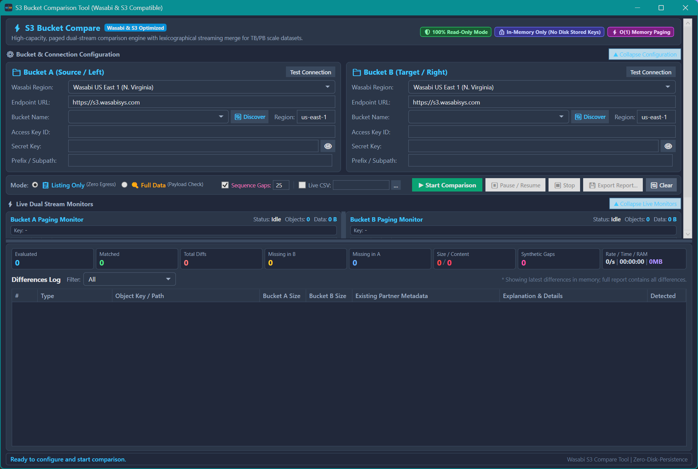
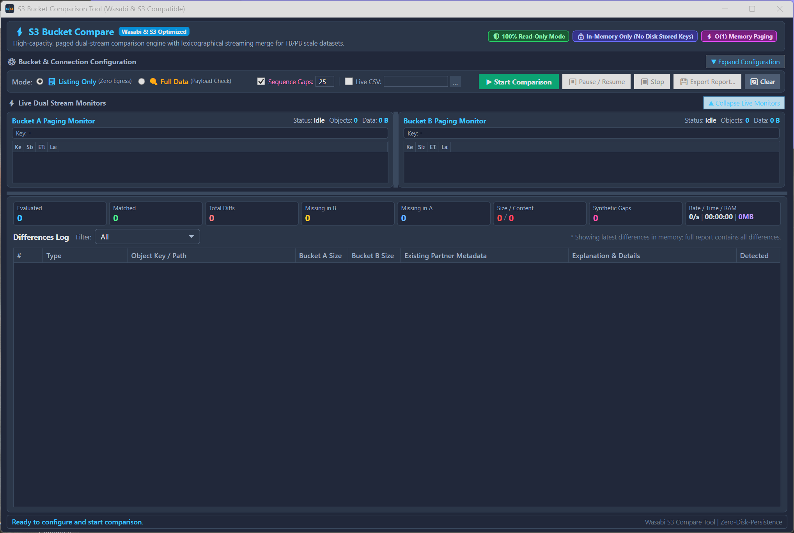
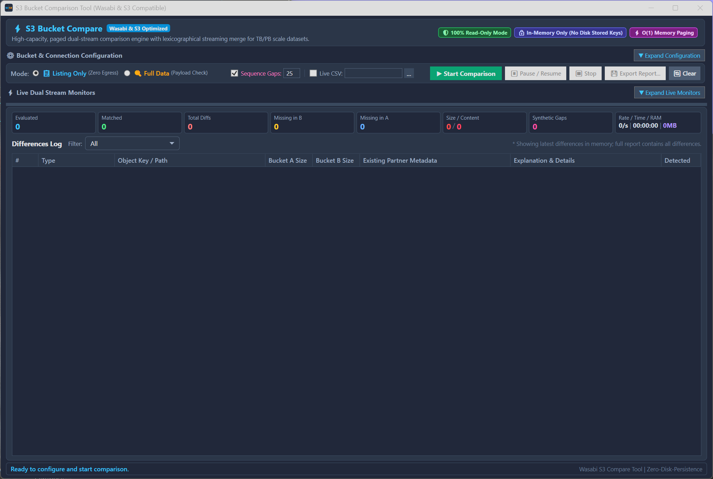

# S3Compare ⚡

[](https://dotnet.microsoft.com/)
[](https://learn.microsoft.com/en-us/dotnet/desktop/wpf/)
[](#enterprise-security--zero-persistence)
[%20Constant%20RAM-D946EF)](#1-o1-constant-memory-paged-streaming)
[](https://wasabi.com/)

A high-performance, dark-themed Windows desktop application built with **.NET 9** and **WPF** for comparing multi-terabyte and petabyte-scale S3-compatible object buckets (tailored for **Wasabi** and fully compatible with **AWS S3**, **MinIO**, **Ceph**, and **Cloudflare R2**).

Designed from the ground up for massive datasets (~300M+ objects), S3Compare uses a **two-way streaming merge diff** with $O(1)$ memory consumption, **parallel key-range partitioning with page prefetch**, resilient atomic checkpointing, synthetic sequence gap detection, live CSV reporting, and a responsive, collapsible UI optimized for high-DPI displays and remote desktop sessions.

---

## 📸 Screenshots

### 1. Full Dashboard View
*Complete view showing dual-bucket connection configuration, Wasabi region presets, comparison mode, sequence gap options, live paging stream monitors, and difference metrics.*



---

### 2. Collapsed Configuration View
*Once bucket credentials and endpoints are configured, collapsing the configuration panel frees up vertical space for monitoring streaming progress and discrepancy rows.*



---

### 3. Ultra-Condensed Discrepancy View
*Collapsing both the configuration cards and live paging monitors dedicates nearly 90% of screen real estate to the Differences Log table and real-time statistics cards—ideal for remote desktop (RDP) sessions and laptop screens.*



---

## ⚡ Key Features

### 1. $O(1)$ Constant-Memory Paged Streaming
Comparing hundreds of terabytes or tens of millions of objects cannot load entire indexes into system memory. 
- S3's `ListObjectsV2` API guarantees lexicographical (UTF-8 binary) ordering for object keys.
- **S3Compare** runs a streaming **two-way merge diff** algorithm:
  - Pages 1,000 objects at a time via `ContinuationToken` from both Bucket A and Bucket B, listing both buckets concurrently and prefetching the next pages in the background (see [High-Throughput Parallel Scanning](#9-high-throughput-parallel-scanning)).
  - Compares the active head keys in $O(1)$ constant memory without in-memory buffering.
  - If $\text{Key}_A == \text{Key}_B$: verifies size, ETag hash, and modification timestamps.
  - If $\text{Key}_A < \text{Key}_B$: flags $\text{Key}_A$ as **Missing in Bucket B** and advances Stream A.
  - If $\text{Key}_A > \text{Key}_B$: flags $\text{Key}_B$ as **Missing in Bucket A** and advances Stream B.
- System working set remains low (~80–140 MB) whether scanning 1,000 or 300,000,000 files: memory is bounded by the pages in flight (about `MaxParallelPartitions × 2 buckets × (PrefetchPages + 2) × 1,000` object summaries), not by bucket size. Validation caps `MaxParallelPartitions × PrefetchPages` at 512, so even the largest allowed settings stay around a million summaries per bucket (on the order of 1 GB in total); the defaults stay around 32,000 per bucket.

### 2. Resumable Scans via Checkpoints (Zero Credentials Saved)
- Scans are automatically and atomically saved to `logs/checkpoints/` about every 5 seconds and whenever you stop the scan or it fails.
- **Strict Zero-Credential Persistence**: Checkpoints record only bucket names, endpoints, prefixes, comparison mode, running counts, and the **partition plan** (each key range's bounds, its last completed key and whether it is done). **No secret keys, access keys, passwords, or authentication headers are ever written to disk.**
- When re-entering a bucket configuration, an alert banner detects unfinished scans and lets you click **"Resume Scan"**: the saved plan is reused, completed ranges are skipped and every other range passes `StartAfter` to S3's `ListObjectsV2` API from its own last completed key—skipping millions of already verified objects instantly.
- **Consistent with the live CSV**: a range's progress is only saved together with the CSV length that contains every difference up to it; on resume the CSV is truncated to that length, so a stop/resume never duplicates or loses rows.
- Checkpoints from earlier versions (a single `LastEvaluatedKey`) are re-planned: the keyspace after that key is split into ranges (the first starts right after it), so the rest of the scan still runs in parallel.

### 3. Synthetic Sequence Gap Detection (Missing on Both Sides)
- Identifies files potentially missing in *both* buckets based on numerical sequencing patterns (e.g., `file_01`, `file_02`, `file_04` detected $\rightarrow$ flags `file_03` as missing).
- Operates in $O(1)$ streaming time across directory paths and filename patterns.
- Each key-range partition has its own detector, so a gap that straddles a partition boundary is not reported. As a result the **gap count can vary with the partition plan** (that is, with `MaxParallelPartitions`, `MaxDiscoveryRequests` and the bucket layout), while all other difference counts never do. A resumed range continues the series of the key it stopped after, so stopping and resuming does not change the result. Set `MaxParallelPartitions` to 1 if you rely on gap detection across a whole listing.
- Configurable **Max Gap Threshold** (default: 25) prevents false alarms from intentional non-sequential numbers.
- Tagged with **Missing on Both Sides (Gap)** in pink (`#EC4899`) on dashboard cards and discrepancy reports.

### 4. Existing Partner Metadata Capture
- When a file exists on one side but is missing in the partner bucket, S3Compare captures the metadata of the file that *does* exist:
  - Exact file size (formatted & raw bytes)
  - ETag / MD5 hash
  - Storage class (`STANDARD`, `GLACIER`, `INTELLIGENT_TIERING`, etc.)
  - Last modified UTC timestamp
- Displayed in the dedicated **Existing Partner Metadata** table column and exported in CSV/JSON reports.

### 5. Cost-Conscious Comparison Modes
- **📋 Listing Only (Zero Egress Cost - Recommended)**:
  - Evaluates metadata returned directly by `ListObjectsV2` (Key, Size, ETag, Storage Class, Last-Modified).
  - Never downloads object byte payloads, preventing unexpected cloud egress transfer costs from Wasabi, AWS, or cloud providers.
- **🔍 Full Data Comparison (Payload Verification)**:
  - When keys and sizes match, streams object byte payloads in 64 KB buffers to verify byte-for-byte content equality.
  - A download that fails for one object (service error such as Glacier `InvalidObjectState` or `AccessDenied`, or a network error / timeout, which is retried once) is recorded as a **Content Check Error** for that key and the scan continues.
  - Displays a confirmation warning before starting to safeguard against inadvertent bandwidth charges.

### 6. Continuous Diagnostics & Crash Logging
- Real-time heartbeat logging flushes every 10 seconds to `logs/scan_diagnostics_YYYY-MM-DD_HH-mm-ss.log`:
  - Every engine phase step, planner progress and failures, and a full diagnostics block (the same text as the UI's Scan Diagnostics panel) - see [Seeing what a scan is doing](#seeing-what-a-scan-is-doing)
  - Current timestamp and active S3 key evaluated
  - Processing rate (`objects/sec`)
  - **Working Set RAM (MB)**, **GC Total Memory (MB)**, and GC Gen 0/1/2 collection counts
- If an unexpected operating system lockup or power outage occurs during massive scans, the log tail records the exact key and memory footprint prior to the interruption.

### 7. Responsive, Compact Dark UI
- Built with custom dark-slate controls (`#0F172A`, `#1E293B`, `#38BDF8`).
- **Scrollable Outer Frame**: Top controls are housed in an auto-scrolling `ScrollViewer`, ensuring all settings, text boxes, and buttons remain accessible on small screens or remote desktop (RDP) sessions.
- **Collapsible Panes**: One-click collapsible headers for **⚙ Configuration** (saves ~180px) and **⚡ Live Monitors** (saves ~130px).
- **Minimum Group Bounds**: Input cards feature guaranteed `MinWidth="380"` to prevent field truncation when resizing.

### 8. Enterprise Security & Zero Persistence
- **100% Read-Only**: Performs exclusively `ListObjectsV2` and streaming read-only `GetObject` operations. Never executes `PutObject`, `DeleteObject`, `CopyObject`, or ACL mutations.
- **In-Memory Only**: Credentials exist solely in volatile memory during the active session. Nothing is written to the Windows Registry, configuration files, or temporary directories. (For the same reason, Performance / Throttling settings are not remembered between sessions; they start at their defaults.)

### 9. High-Throughput Parallel Scanning
`ListObjectsV2` pages of one listing are strictly sequential (each needs the previous page's opaque continuation token), so a single listing can never go faster than 1,000 keys per round trip. S3Compare removes that ceiling in two ways:

1. **Prefetch + concurrent A/B**: each listing runs on a background producer that requests page N+1 as soon as page N arrives, into a bounded buffer of `PrefetchPages` pages. Bucket A and Bucket B are listed at the same time, so a page costs one round trip instead of latency(A) + latency(B).
2. **Key-range partitioning**: S3 lists keys in UTF-8 byte order, so the keyspace (relative to each bucket's own prefix) is split into ranges `(lower, upper]` that are compared by independent merge-joins. Each range lists both buckets with `StartAfter = prefix + lower` and stops after `upper`.
   - **Planning** (before the scan, at most `MaxDiscoveryRequests` LIST calls): `Delimiter="/"` listings on both buckets, descending up to 3 folder levels, collect folder names as candidate boundaries. Flat namespaces fall back to rounds of `MaxKeys=1` probes that sample real keys: the first round probes each printable ASCII first character, and every later round probes one character deeper under each populated prefix found so far. Keys with a long shared prefix and no `/` (`file_00001.dat`, `IMG_0001.jpg`, `logs-2024-…`) are descended until they branch, with no depth cap; a prefix with a single child costs only a few probes because probes whose answer is already known are not sent. Probes are issued coarse to fine (spread over the whole character range first) and the remaining budget is split between the buckets, so a small budget still covers the whole keyspace. About `MaxParallelPartitions × 4` evenly spaced boundaries are chosen; workers pull ranges from a queue so uneven ranges balance out.
   - **Planning is bounded and visible.** Independent planner requests (the folders of one level, a wave of probes) run concurrently, up to 8 per bucket, within the request budget and the rate limiter. Every planner request has a 15 s timeout and is abandoned even if the connection ignores cancellation; a failed or timed-out request is logged and skipped, never fatal. If a bucket rejects the delimiter listing it is switched to probes for the rest of the plan (logged once); probing is switched off for a bucket after 3 failures in a row. The planner only ever uses ordinary `StartAfter` values (the prefix plus a printable ASCII character), never a U+10FFFF-style sentinel. Only stopping the scan aborts planning. Progress is shown live (see [Seeing what a scan is doing](#seeing-what-a-scan-is-doing)).
   - The ranges always tile the keyspace exactly, so **planning quality only affects speed, never results**: a partitioned scan reports exactly the same differences and counts as a single-stream scan.

All partitions share one live CSV writer, one statistics aggregate, the pause button and the throttles. Pausing also holds planning between requests.

#### Seeing what a scan is doing

The UI is built so that a screenshot is enough to diagnose a slow or stalled scan.

- **Phase chip and step** (top of the results panel, and a small chip at the left of the status bar): `PLANNING`, `SCANNING`, `FINALIZING` or `PAUSED` (also `STOPPED`/`FAILED`/`COMPLETED`), plus the latest engine step (`Step: ...`). Every step is also written to the diagnostics log.
- **Status bar while planning**: `[PLANNING] <step> | requests used/budget | candidates | elapsed of time limit | failed N | TIME LIMIT REACHED`. The step names what the planner is doing per bucket, for example `A: delimiter depth 2/3 (14 folders) | B: probe round 4: shared-prefix jump to depth 3 ('fil', 1 prefixes)`.
- **Waiting on a request**: when the oldest in-flight request is older than 3 s the status bar appends `waiting on: LIST A bucket '...' prefix='...' startAfter='...' delimiter='...' maxKeys=... | age 31.0s | attempt 2`. In-flight operations also include the CSV writer (`CSV writer: writing N row(s) ...`) when a disk write is slow.
- **Scan Diagnostics expander** (below the phase strip; expand it before taking the screenshot): phase and latest step; planner state (running/finished, step, requests used/budget, failed requests, candidates, elapsed/limit, disabled techniques, last planner error); partitions done/running; per bucket the LIST request count, failures, recent requests/s, average and last page latency and rate-limiter wait; total LIST requests; in-flight operations (with age and attempt); and the last error. Next to it a per-partition table: index, lower bound, upper bound, state (Pending/Running/Done), last completed key and keys compared (this run only; after a resume the count restarts at 0).
- **Diagnostics log**: the same text is written to `logs/scan_diagnostics_*.log` every 10 s (`[DIAGNOSTICS] periodic`), at abandon, together with every phase step, planner start/finish lines, each distinct planner failure and a disabled-technique notice.

**Stop and the watchdog.** Press Stop and the status bar shows `Stopping... (N s)` (plus the request it is waiting on). Cancellation reaches every LIST and download even when the HTTP layer ignores it, so a stop normally completes in well under a second. If the engine has not finished after 20 s (a hung disk write, say) the stuck operations are logged and shown, the checkpoint that is consistent with the live CSV is saved (when the writer is not itself stuck; otherwise the last periodic checkpoint stays valid), the engine is detached so it can no longer write CSV rows, raise differences or touch checkpoints, and the UI returns to idle: **Resume Scan** is offered as usual. Closing the window uses the same watchdog.

**Timeouts and retries.** The SDK's own retries are turned off for the scan's clients (`MaxErrorRetry = 0`, HTTP timeout 30 s per attempt, so no more silent multi-minute stalls: the old settings, 45 s and 3 retries, let one hung request take about 3 minutes). `ListObjectsV2` calls are retried by S3Compare itself, up to 3 attempts of at most 30 s each with 1 s/2 s pauses, for timeouts, network errors, throttling and 5xx answers (not for access-denied or no-such-bucket); the attempt number is shown in the in-flight list. Full Data downloads keep their own 2-attempt retry. Connection tests and bucket discovery still use the SDK default (30 s, 2 retries).

#### Settings, sizing and cost

| Setting | Default | Meaning |
|---|---|---|
| `MaxParallelPartitions` | 8 | Key ranges compared concurrently (1–256). `1` = one range, still prefetching. |
| `PrefetchPages` | 2 | Pages buffered ahead per listing (1–64). `MaxParallelPartitions × PrefetchPages` must be at most 512, which bounds memory. |
| `MaxListRequestsPerSecond` | 20 | Requests per second **per bucket**, shared by all partitions (token bucket, 1 s burst). Also covers planning and Full Data downloads. `0` = unlimited. |
| `MaxObjectsPerSecond` | 0 | Aggregate cap on keys compared per second (token bucket, consumed in batches). One token per key: a key present in both buckets costs 1, as does a key present in only one. `0` = unlimited. |
| `MaxConcurrentContentChecks` | 8 | Full Data mode: object pairs downloaded at the same time across all partitions (1–256). |
| `MaxDiscoveryRequests` | 500 | LIST budget for partition planning, both buckets together (0–100,000). `0` = no planning (one range). |
| `MaxPlanningSeconds` | 60 | Time box for planning (0-86,400 s; **0 = unlimited**). When it is exceeded the planner stops sending requests and builds ranges from the candidates found so far, so a slow endpoint cannot delay the scan start indefinitely; the plan is coarser but still tiles the keyspace, so results are unaffected. Paused time does not count. |

Set them in the collapsible **🚀 Performance / Throttling** section under the options bar (each field has a tooltip). They are validated when you start a scan. They do not affect correctness, so a checkpoint can be resumed with different values (the saved partition plan is reused). The setting names are identical in the sister project S3CompareService.

**Sizing.** Throughput is roughly

> objects/s ≈ `MaxParallelPartitions` × 1,000 / page latency (s), capped at `MaxListRequestsPerSecond` × 1,000 per bucket

For example, at 100 ms per LIST page, 8 partitions give ~80,000 objects/s, but the default 20 requests/s cap holds that to ~20,000 objects/s (~4 hours for 300M objects). Raising the cap to 100 and partitions to 16 allows ~100,000 objects/s if the endpoint keeps up. Each S3 client is configured with `MaxConnectionsPerServer ≥ 2 × partitions + content checks`. Watch for `SlowDown`/503 responses in the diagnostics log and lower the request cap if they appear.

**Request cost.** A full scan issues about one LIST per 1,000 objects per bucket, plus up to `MaxDiscoveryRequests` for planning: ~300,000 LIST requests per bucket for 300M objects. On AWS S3 Standard, LIST requests are billed (on the order of USD 0.005 per 1,000 at the time of writing, i.e. ~USD 1.50 per bucket for 300M objects); Wasabi does not charge per API request. Parallelism changes how fast the requests are made, not how many.

**Report order.** Differences are found out of key order, so the live CSV is in discovery order. Exported reports (CSV and JSON) of up to 200,000 rows are sorted by key; larger reports keep discovery order (sort them in a database or spreadsheet). The summary sidecar says which order applies.

---

## 🛠️ Wasabi Region Presets

Pre-configured with direct dropdown selection for all Wasabi global storage regions:
- **US East 1** (`https://s3.wasabisys.com` - N. Virginia)
- **US East 2** (`https://s3.us-east-2.wasabisys.com` - N. Virginia)
- **US Central 1** (`https://s3.us-central-1.wasabisys.com` - Texas)
- **US West 1** (`https://s3.us-west-1.wasabisys.com` - Oregon)
- **EU Central 1** (Amsterdam), **EU Central 2** (Frankfurt)
- **EU West 1** (London), **EU West 2** (Paris), **EU South 1** (Milan)
- **AP Northeast 1** (Tokyo), **AP Northeast 2** (Osaka)
- **AP Southeast 1** (Singapore), **AP Southeast 2** (Sydney)
- **CA Central 1** (Toronto)
- **AWS S3 Standard** & **Custom Endpoint Support** (for private clouds, MinIO, Ceph, or Cloudflare R2)

---

## 🚀 Building and Running

### Prerequisites
- Windows 10 or Windows 11
- [.NET 9.0 SDK](https://dotnet.microsoft.com/download/dotnet/9.0) or Visual Studio 2022 (v17.12+)

### Run via Command Line
```powershell
# Clone the repository
git clone https://github.com/lesingerd/S3Compare.git
cd S3Compare

# Run the WPF application
dotnet run --project S3Compare.App/S3Compare.App.csproj
```

### Run Automated Tests
```powershell
dotnet test
```
*Runs all 108 automated xUnit tests validating the streaming two-way merge diff, the prefetching listing stream, the partition planner (hierarchical, flat, unicode, different prefixes), partitioned-vs-single-stream equivalence, cancel/resume CSV consistency, planner time box and request resilience, in-flight diagnostics and the stop watchdog (including listers that ignore cancellation), throttling, sequence gap detector, checkpoint save/load/delete roundtrips, partner metadata capture, report export, and WPF window instantiation. An in-memory fake `ListObjectsV2` (with latency and fault injection) keeps them fast.*

### Publish Standalone Executable
```powershell
dotnet publish S3Compare.App/S3Compare.App.csproj -c Release -o ./publish
```
The compiled binary will be generated at `publish\S3Compare.App.exe` with the embedded application icon.

---

## 📂 Project Structure

```
S3Compare/
├── S3Compare.App/                      # WPF Desktop UI Application (.NET 9)
│   ├── Converters/                     # Value converters (DifferenceType to Brush, InverseBoolean)
│   ├── Models/                         # Comparison models, checkpoints, and statistics
│   ├── Services/
│   │   ├── BucketComparisonEngine.cs   # Partitioned two-way streaming merge diff engine
│   │   ├── CheckpointManager.cs        # Atomic checkpoint save/resume manager
│   │   ├── DiagnosticsFormatter.cs     # Plain-text diagnostics block (UI panel and log)
│   │   ├── IS3Lister.cs                # ListObjectsV2 abstraction (+ AmazonS3Lister)
│   │   ├── IS3ObjectStream.cs          # Streaming interface abstraction
│   │   ├── ListDiagnostics.cs          # Request metrics, in-flight tracking, cancellable lister decorator
│   │   ├── PartitionPlanner.cs         # Splits the keyspace into key ranges
│   │   ├── PrefetchingObjectStream.cs  # Background-prefetching paged listing of a key range
│   │   ├── ReportExporter.cs           # CSV and JSON report exporter
│   │   ├── S3ClientFactory.cs          # S3/Wasabi client factory and presets
│   │   ├── ScanDiagnosticsLogger.cs    # Async memory, GC, and rate heartbeat logger
│   │   ├── SequenceGapDetector.cs      # O(1) streaming numerical sequence gap detector
│   │   └── TokenBucketRateLimiter.cs   # Request / object rate limits
│   ├── ViewModels/                     # MVVM ViewModel with throttled UI dispatching
│   ├── MainWindow.xaml                 # Responsive, collapsible dark-theme WPF UI
│   ├── icon.ico                        # Multi-resolution embedded application icon
│   └── icon.png                        # Application icon source asset
├── S3Compare.Tests/                    # Automated xUnit Test Suite
│   ├── FakeS3Lister.cs                 # In-memory ListObjectsV2 with latency/fault injection
│   ├── MainWindowTests.cs              # UI and window instantiation tests
│   ├── PlanningVisibilityTests.cs      # Planner time box, resilience, concurrency, diagnostics, abandon watchdog
│   ├── ParallelEngineTests.cs          # Partitioned engine equivalence, resume, throttling
│   ├── PrefetchAndPlannerTests.cs      # Prefetch stream, rate limiter, partition planner
│   └── StreamingComparisonTests.cs     # Gap detection, checkpoint, and comparison tests
├── Screenshot1.png                     # Full UI screenshot
├── Screenshot2.png                     # Collapsed configuration screenshot
├── Screenshot3.png                     # Ultra-condensed table screenshot
├── S3Compare.slnx                      # Visual Studio Solution file
└── README.md                           # Documentation
```

---

## 📄 License

Distributed under the MIT License. See `LICENSE` for details.
