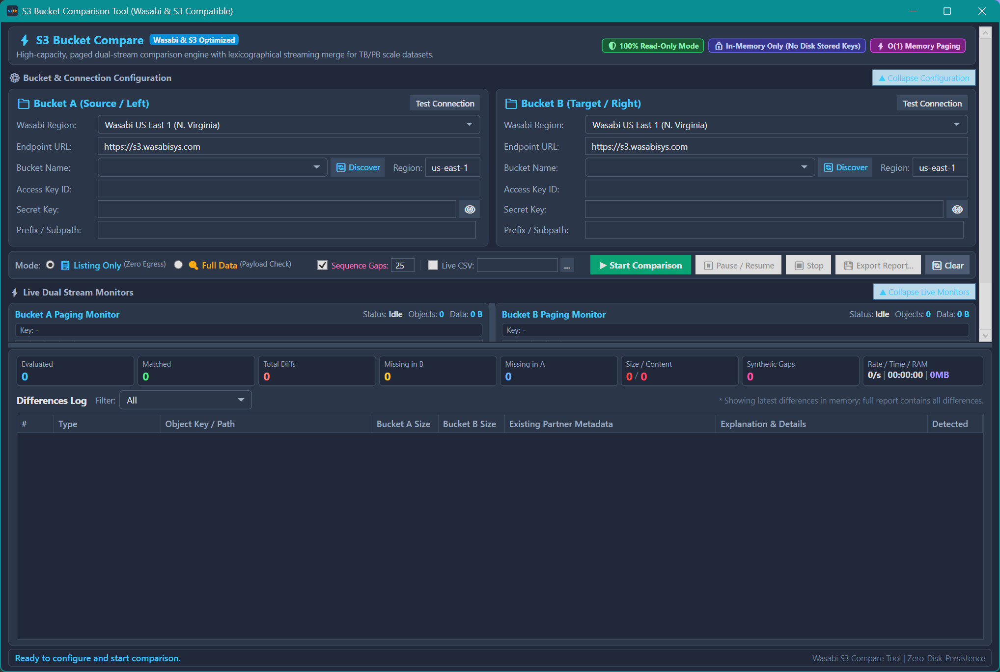
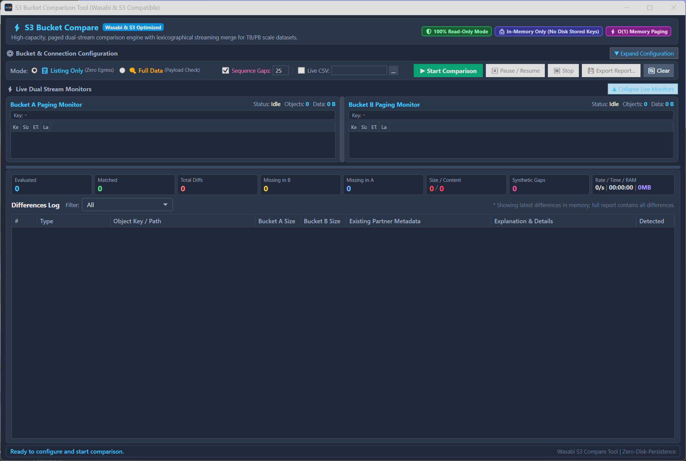
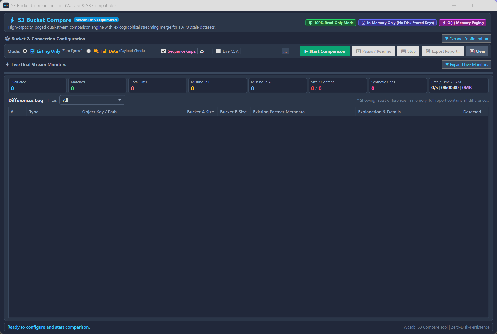

# S3Compare ⚡

[](https://dotnet.microsoft.com/)
[](https://learn.microsoft.com/en-us/dotnet/desktop/wpf/)
[](#enterprise-security--zero-persistence)
[%20Constant%20RAM-D946EF)](#1-o1-constant-memory-paged-streaming)
[](https://wasabi.com/)

A high-performance, dark-themed Windows desktop application built with **.NET 9** and **WPF** for comparing multi-terabyte and petabyte-scale S3-compatible object buckets (tailored for **Wasabi** and fully compatible with **AWS S3**, **MinIO**, **Ceph**, and **Cloudflare R2**).

Designed from the ground up for massive datasets (~300M+ objects), S3Compare uses a **two-way streaming merge diff** with $O(1)$ memory consumption, resilient atomic checkpointing, synthetic sequence gap detection, live CSV reporting, and a responsive, collapsible UI optimized for high-DPI displays and remote desktop sessions.

---

## 📸 Screenshots

### 1. Full Dashboard View
*Complete view showing dual-bucket connection configuration, Wasabi region presets, comparison mode, sequence gap options, live paging stream monitors, and difference metrics.*



---

### 2. Collapsed Configuration View
*Once bucket credentials and endpoints are configured, collapsing the configuration panel frees up vertical space for monitoring streaming progress and discrepancy rows.*



---

### 3. Ultra-Condensed Discrepancy View
*Collapsing both the configuration cards and live paging monitors dedicates nearly 90% of screen real estate to the Differences Log table and real-time statistics cards—ideal for remote desktop (RDP) sessions and laptop screens.*



---

## ⚡ Key Features

### 1. $O(1)$ Constant-Memory Paged Streaming
Comparing hundreds of terabytes or tens of millions of objects cannot load entire indexes into system memory. 
- S3's `ListObjectsV2` API guarantees lexicographical (UTF-8 binary) ordering for object keys.
- **S3Compare** runs a streaming **two-way merge diff** algorithm:
  - Concurrently pages 1,000 objects at a time via `ContinuationToken` from both Bucket A and Bucket B.
  - Compares the active head keys in $O(1)$ constant memory without in-memory buffering.
  - If $\text{Key}_A == \text{Key}_B$: verifies size, ETag hash, and modification timestamps.
  - If $\text{Key}_A < \text{Key}_B$: flags $\text{Key}_A$ as **Missing in Bucket B** and advances Stream A.
  - If $\text{Key}_A > \text{Key}_B$: flags $\text{Key}_B$ as **Missing in Bucket A** and advances Stream B.
- System working set remains low (~80–140 MB) whether scanning 1,000 or 300,000,000 files.

### 2. Resumable Scans via Checkpoints (Zero Credentials Saved)
- Scans are automatically and atomically saved to `logs/checkpoints/` every 5,000 objects and whenever you pause or cancel.
- **Strict Zero-Credential Persistence**: Checkpoints record only bucket names, endpoints, prefixes, comparison mode, running counts, and the `LastEvaluatedKey`. **No secret keys, access keys, passwords, or authentication headers are ever written to disk.**
- When re-entering a bucket configuration, an alert banner detects unfinished scans and lets you click **"Resume Scan"** to pass `StartAfter` to S3's `ListObjectsV2` API—skipping millions of already verified objects instantly.

### 3. Synthetic Sequence Gap Detection (Missing on Both Sides)
- Identifies files potentially missing in *both* buckets based on numerical sequencing patterns (e.g., `file_01`, `file_02`, `file_04` detected $\rightarrow$ flags `file_03` as missing).
- Operates in $O(1)$ streaming time across directory paths and filename patterns.
- Configurable **Max Gap Threshold** (default: 25) prevents false alarms from intentional non-sequential numbers.
- Tagged with **Missing on Both Sides (Gap)** in pink (`#EC4899`) on dashboard cards and discrepancy reports.

### 4. Existing Partner Metadata Capture
- When a file exists on one side but is missing in the partner bucket, S3Compare captures the metadata of the file that *does* exist:
  - Exact file size (formatted & raw bytes)
  - ETag / MD5 hash
  - Storage class (`STANDARD`, `GLACIER`, `INTELLIGENT_TIERING`, etc.)
  - Last modified UTC timestamp
- Displayed in the dedicated **Existing Partner Metadata** table column and exported in CSV/JSON reports.

### 5. Cost-Conscious Comparison Modes
- **📋 Listing Only (Zero Egress Cost - Recommended)**:
  - Evaluates metadata returned directly by `ListObjectsV2` (Key, Size, ETag, Storage Class, Last-Modified).
  - Never downloads object byte payloads, preventing unexpected cloud egress transfer costs from Wasabi, AWS, or cloud providers.
- **🔍 Full Data Comparison (Payload Verification)**:
  - When keys and sizes match, streams object byte payloads in 64 KB buffers to verify byte-for-byte content equality.
  - Displays a confirmation warning before starting to safeguard against inadvertent bandwidth charges.

### 6. Continuous Diagnostics & Crash Logging
- Real-time heartbeat logging flushes every 10 seconds to `logs/scan_diagnostics_YYYY-MM-DD_HH-mm-ss.log`:
  - Current timestamp and active S3 key evaluated
  - Processing rate (`objects/sec`)
  - **Working Set RAM (MB)**, **GC Total Memory (MB)**, and GC Gen 0/1/2 collection counts
- If an unexpected operating system lockup or power outage occurs during massive scans, the log tail records the exact key and memory footprint prior to the interruption.

### 7. Responsive, Compact Dark UI
- Built with custom dark-slate controls (`#0F172A`, `#1E293B`, `#38BDF8`).
- **Scrollable Outer Frame**: Top controls are housed in an auto-scrolling `ScrollViewer`, ensuring all settings, text boxes, and buttons remain accessible on small screens or remote desktop (RDP) sessions.
- **Collapsible Panes**: One-click collapsible headers for **⚙ Configuration** (saves ~180px) and **⚡ Live Monitors** (saves ~130px).
- **Minimum Group Bounds**: Input cards feature guaranteed `MinWidth="380"` to prevent field truncation when resizing.

### 8. Enterprise Security & Zero Persistence
- **100% Read-Only**: Performs exclusively `ListObjectsV2` and streaming read-only `GetObject` operations. Never executes `PutObject`, `DeleteObject`, `CopyObject`, or ACL mutations.
- **In-Memory Only**: Credentials exist solely in volatile memory during the active session. Nothing is written to the Windows Registry, configuration files, or temporary directories.

---

## 🛠️ Wasabi Region Presets

Pre-configured with direct dropdown selection for all Wasabi global storage regions:
- **US East 1** (`https://s3.wasabisys.com` - N. Virginia)
- **US East 2** (`https://s3.us-east-2.wasabisys.com` - N. Virginia)
- **US Central 1** (`https://s3.us-central-1.wasabisys.com` - Texas)
- **US West 1** (`https://s3.us-west-1.wasabisys.com` - Oregon)
- **EU Central 1** (Amsterdam), **EU Central 2** (Frankfurt)
- **EU West 1** (London), **EU West 2** (Paris), **EU South 1** (Milan)
- **AP Northeast 1** (Tokyo), **AP Northeast 2** (Osaka)
- **AP Southeast 1** (Singapore), **AP Southeast 2** (Sydney)
- **CA Central 1** (Toronto)
- **AWS S3 Standard** & **Custom Endpoint Support** (for private clouds, MinIO, Ceph, or Cloudflare R2)

---

## 🚀 Building and Running

### Prerequisites
- Windows 10 or Windows 11
- [.NET 9.0 SDK](https://dotnet.microsoft.com/download/dotnet/9.0) or Visual Studio 2022 (v17.12+)

### Run via Command Line
```powershell
# Clone the repository
git clone https://github.com/lesingerd/S3Compare.git
cd S3Compare

# Run the WPF application
dotnet run --project S3Compare.App/S3Compare.App.csproj
```

### Run Automated Tests
```powershell
dotnet test
```
*Runs all 18 automated xUnit tests validating the streaming two-way merge diff, sequence gap detector, checkpoint save/load/delete roundtrips, partner metadata capture, and WPF window instantiation.*

### Publish Standalone Executable
```powershell
dotnet publish S3Compare.App/S3Compare.App.csproj -c Release -o ./publish
```
The compiled binary will be generated at `publish\S3Compare.App.exe` with the embedded application icon.

---

## 📂 Project Structure

```
S3Compare/
├── S3Compare.App/                      # WPF Desktop UI Application (.NET 9)
│   ├── Converters/                     # Value converters (DifferenceType to Brush, InverseBoolean)
│   ├── Models/                         # Comparison models, checkpoints, and statistics
│   ├── Services/
│   │   ├── BucketComparisonEngine.cs   # Two-way streaming merge diff engine
│   │   ├── CheckpointManager.cs        # Atomic checkpoint save/resume manager
│   │   ├── IS3ObjectStream.cs          # Streaming interface abstraction
│   │   ├── ReportExporter.cs           # CSV and JSON report exporter
│   │   ├── S3ClientFactory.cs          # S3/Wasabi client factory and presets
│   │   ├── S3PagingEnumerator.cs       # Paged S3 enumerator using ContinuationToken
│   │   ├── ScanDiagnosticsLogger.cs    # Async memory, GC, and rate heartbeat logger
│   │   └── SequenceGapDetector.cs      # O(1) streaming numerical sequence gap detector
│   ├── ViewModels/                     # MVVM ViewModel with throttled UI dispatching
│   ├── MainWindow.xaml                 # Responsive, collapsible dark-theme WPF UI
│   ├── icon.ico                        # Multi-resolution embedded application icon
│   └── icon.png                        # Application icon source asset
├── S3Compare.Tests/                    # Automated xUnit Test Suite
│   ├── MainWindowTests.cs              # UI and window instantiation tests
│   └── StreamingComparisonTests.cs     # Gap detection, checkpoint, and comparison tests
├── Screenshot1.png                     # Full UI screenshot
├── Screenshot2.png                     # Collapsed configuration screenshot
├── Screenshot3.png                     # Ultra-condensed table screenshot
├── S3Compare.slnx                      # Visual Studio Solution file
└── README.md                           # Documentation
```

---

## 📄 License

Distributed under the MIT License. See `LICENSE` for details.
